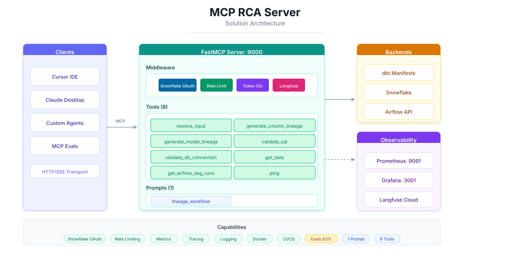
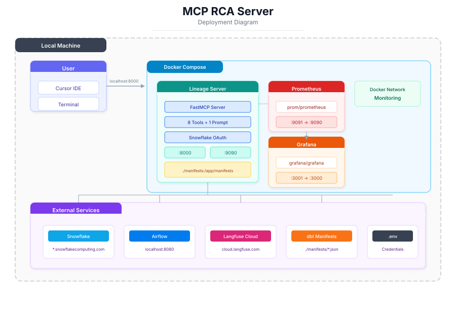

# MCP RCA Server

A Model Context Protocol (MCP) server for dbt lineage analysis, SQL validation, and data exploration with Snowflake and Airflow integration.

## 🏗️ Architecture

<p align="center">
  
</p>

## 🚀 Deployment

<p align="center">
  
</p>

## 🛠️ MCP Tools

The server provides **8 tools** and **1 prompt** for AI agents:

| Tool | Description |
|------|-------------|
| 1. 🔍 **resolve_input** | **Call this first** for any lineage request. Validates `data_product`, `model_name`, and optional `column_name`. Returns available options if validation fails. |
| 2. 📊 **generate_column_lineage** | Trace a column through upstream dbt models and sources. Returns compiled SQL, source columns, and derivation logic. |
| 3. 🌳 **generate_model_lineage** | Trace upstream dependencies of a dbt model. Returns the full dependency tree with model metadata. |
| 4. ✅ **validate_sql** | Validate SQL syntax and schema references against Snowflake without executing. Uses `EXPLAIN` to check compilation. |
| 5. 🔌 **validate_db_connection** | Test if the Snowflake database is up and running. Returns server time if successful. |
| 6. 📥 **get_data** | Execute a read-only SELECT query against Snowflake. Returns up to 10 rows. Rejects `SELECT *` queries. |
| 7. ✈️ **get_airflow_dag_runs** | Get Airflow DAG run details for a specific date: run count, status, duration, and task logs. |
| 8. 🏓 **ping** | Test if the MCP server is responding. Returns a simple success message. |

### 📋 Prompts

| Prompt | Description |
|--------|-------------|
| `lineage_workflow` | Instructions for AI agents on how to use lineage tools effectively |

## ⚙️ Server Features

This MCP server is built with production-grade capabilities organized into six categories:

### 1️⃣ Authentication

**Snowflake OAuth**

Custom OAuth provider that authenticates users via Snowflake's OAuth flow. Configured in `src/rca_server/auth/snowflake_provider.py`.

- Role-based scopes using `session:role:ROLE_NAME` format
- Supports multiple roles via comma-separated `SNOWFLAKE_OAUTH_ROLES`

**OAuth Token Reuse**

Middleware captures the OAuth access token and reuses it for Snowflake database connections, enabling single sign-on where MCP authentication equals database authentication.

- Implemented via context variable in `src/rca_server/snowflake_connection.py`
- Eliminates need for separate database credentials

### 2️⃣ Guardrails

**Query Type Restriction**

The `get_data` and `validate_sql` tools enforce read-only access by rejecting any DDL or DML statements. Only SELECT queries are permitted.

- Implemented via `_check_query_policy()` in `src/rca_server/tools/validate_sql.py`
- Uses sqlglot for safe SQL parsing without execution
- Rejects: INSERT, UPDATE, DELETE, DROP, CREATE, ALTER, TRUNCATE, etc.
- Also rejects `SELECT *` to prevent unbounded data retrieval

**Row Limit Enforcement**

The `get_data` tool automatically caps query results to a maximum of 10 rows to prevent excessive data transfer.

- Implemented via `_enforce_limit()` in `src/rca_server/tools/get_data.py`
- Uses sqlglot to parse and modify the query's LIMIT clause
- If no LIMIT specified: adds `LIMIT 10`
- If LIMIT > 10: caps it to `LIMIT 10`

### 3️⃣ Middleware

**Rate Limiting**

Built-in rate limiting using FastMCP's `RateLimitingMiddleware` to prevent abuse and ensure fair usage.

- Configurable via `RATE_LIMIT_RPS` (default: 10 requests/sec)
- Burst capacity via `RATE_LIMIT_BURST` (default: 10)
- Applied to all tool calls

**Request Logging**

Structured logging via custom logger module with multiple levels for debugging and monitoring.

- Debug, info, warning, and error levels
- Configured in `src/rca_server/logger.py`
- Includes request context and timing

### 4️⃣ Observability

**Prometheus Metrics**

Automatic instrumentation using `observatory_sdk` that wraps the FastMCP server.

- Tool call count, latency, and error metrics
- Exposed on configurable port (default `:9090`)
- Scrape-ready for Prometheus

**Langfuse Tracing**

Distributed tracing using Langfuse with automatic user tracking from OAuth context.

- `@observe` decorator on all tool functions
- User tracking middleware extracts email from OAuth token
- Trace correlation across tool calls
- Configured in `src/rca_server/langfuse_connection_manager.py`

**Grafana Dashboards**

Pre-configured dashboards for visualizing server metrics.

- Auto-provisioned via Docker Compose
- Located in `grafana/dashboards/`
- Visualizes Prometheus metrics

### 5️⃣ Testing & Quality

**CI/CD Pipeline**

GitHub Actions workflow for automated testing and deployment.

- Automated pytest on push/PR to main branch
- MCP evals with **85% pass threshold** (CI fails if below)
- Docker image build and push to GitHub Container Registry
- Build caching for faster iterations
- Configured in `.github/workflows/ci.yml`
- Requires `OPENAI_API_KEY` secret in GitHub repository settings

**MCP Evals**

LLM-judged evaluation framework using `mcpeval` to test agent interactions.

- Configuration in `mcpeval.yaml`
- Test suites in `evals/` directory:
  - `test_lineage_tools.py` - Column/model lineage tests
  - `test_data_retrieval.py` - Data query tests
  - `test_sql_validation.py` - SQL validation tests
- OpenAI GPT-4o-mini as judge with 0.7 minimum score threshold
- HTML and JSON report generation in `eval-reports/`
- Set `TESTING=true` to disable auth for local eval runs


### 6️⃣ Deployment

**Docker Compose**

Production-ready container deployment with monitoring stack.

- 3-container setup: rca-server, prometheus, grafana
- Shared `monitoring` network for inter-container communication
- Volume mounts for manifests and dashboard persistence
- Configured in `docker-compose.yml`

## 📦 Installation

```bash
pip install -e .
```

For development:
```bash
pip install -e ".[dev]"
```

## ▶️ Usage

Run the server:

```bash
rca-server
```

The server starts on port 8000 by default with:
- MCP endpoint: `http://localhost:8000`
- Prometheus metrics: `http://localhost:9090/metrics`

## 🔧 Configuration

### Environment Variables

Create a `.env` file with the following variables:

#### Authentication (Snowflake OAuth)

```bash
SNOWFLAKE_ACCOUNT=your-account
SNOWFLAKE_OAUTH_CLIENT_ID=your-client-id
SNOWFLAKE_OAUTH_CLIENT_SECRET=your-client-secret
SNOWFLAKE_OAUTH_ROLES=PUBLIC,ANALYST_ROLE
SERVER_BASE_URL=http://localhost:8000
```

#### Airflow
```bash
AIRFLOW_BASE_URL=http://localhost:8080
AIRFLOW_USERNAME=airflow
AIRFLOW_PASSWORD=airflow
```

#### Observability (optional)
```bash
PROMETHEUS_PORT=9090
LANGFUSE_SECRET_KEY=your-secret-key
LANGFUSE_PUBLIC_KEY=your-public-key
LANGFUSE_HOST=https://cloud.langfuse.com
```

#### Rate Limiting
```bash
RATE_LIMIT_RPS=10.0
RATE_LIMIT_BURST=10
```

### Data Products

Configure data products in `manifests/data_products.json`:

```json
{
  "flight_analytics": {
    "database_name": "FLIGHT_ANALYTICS",
    "airflow_dag_name": "dbt_flight_information_daily"
  }
}
```

#### dbt Manifest Files

**Current Limitation**: In the current version, dbt manifest files are embedded directly in the MCP server repository. This means you must manually copy the manifest from each dbt data product repository to this repo.

**Workflow**:
1. After running `dbt compile` or `dbt build` in your dbt project, locate the generated `manifest.json` in the `target/` directory
2. Copy it to this repository: `manifests/<data_product>/manifest.json`
3. Run `python -c "from src.rca_server.manifest_utils import ensure_slim_manifest; ensure_slim_manifest('<data_product>')"` to generate the optimized slim manifest
4. Rebuild the Docker container to include the updated manifest

**Directory Structure**:
```
manifests/
├── data_products.json
├── flight_analytics/
│   ├── manifest.json        # Full dbt manifest (copied from dbt repo)
│   └── manifest_slim.json   # Auto-generated slim version
└── customer_orders/
    ├── manifest.json
    └── manifest_slim.json
```

**Note**: Future versions may support fetching manifests dynamically from a remote location (e.g., S3, artifact registry) to decouple the MCP server from individual dbt projects.

## 🖥️ Cursor Integration

Add to `~/.cursor/mcp.json`:

### Docker Deployment (Recommended)

When running the server via Docker Compose:

```json
{
  "mcpServers": {
    "data-product-rca": {
      "url": "http://localhost:8000/mcp",
      "transport": "http"
    }
  }
}
```

### Local Development

When running `rca-server` directly (without Docker):

```json
{
  "mcpServers": {
    "data-product-rca": {
      "command": "rca-server",
      "env": {
        "TESTING": "true"
      }
    }
  }
}
```

### Testing Without OAuth

For local development and testing without Snowflake OAuth authentication:

1. **Set `TESTING=true`** in your `.env` file:
   ```bash
   TESTING=true
   ```

2. **Restart the container:**
   ```bash
   docker compose down rca-server
   docker compose up -d rca-server
   ```

3. **Verify OAuth is disabled:**
   ```bash
   curl http://localhost:8000/mcp -X POST \
     -H "Content-Type: application/json" \
     -H "Accept: application/json, text/event-stream" \
     -d '{"jsonrpc":"2.0","method":"initialize","params":{"protocolVersion":"2024-11-05","capabilities":{},"clientInfo":{"name":"test","version":"1.0"}},"id":1}'
   ```
   You should receive a successful response without 401 Unauthorized.

> **Note:** When OAuth is enabled (`TESTING=false`), Cursor will prompt you to authenticate via Snowflake when you first use the MCP tools. The OAuth flow will redirect you to Snowflake's login page.


## 🐳 Docker

Run with Docker Compose (includes Prometheus and Grafana):

```bash
docker compose up
```

Or run just the MCP server:

```bash
docker compose up -d rca-server
```

**Quick Test:**

```bash
# Initialize session and ping
SESSION_ID=$(curl -sD - http://localhost:8000/mcp -X POST \
  -H "Content-Type: application/json" \
  -H "Accept: application/json, text/event-stream" \
  -d '{"jsonrpc":"2.0","method":"initialize","params":{"protocolVersion":"2024-11-05","capabilities":{},"clientInfo":{"name":"test","version":"1.0"}},"id":1}' \
  | grep -i "mcp-session-id" | cut -d: -f2 | tr -d ' \r')

curl -s http://localhost:8000/mcp -X POST \
  -H "Content-Type: application/json" \
  -H "Accept: application/json, text/event-stream" \
  -H "Mcp-Session-Id: $SESSION_ID" \
  -d '{"jsonrpc":"2.0","method":"tools/call","params":{"name":"ping","arguments":{}},"id":2}'
```

**Services:**

| Service | URL | Description |
|---------|-----|-------------|
| MCP Server | `http://localhost:8000/mcp` | MCP endpoint (Streamable HTTP) |
| Prometheus | `http://localhost:9091` | Metrics scraping |
| Grafana | `http://localhost:3001` | Dashboards (admin/admin) |

## 📁 Project Structure

```
├── pyproject.toml
├── README.md
├── docker-compose.yml
├── manifests/
│   ├── data_products.json          # Data product configuration
│   └── <data_product>/
│       └── manifest.json           # dbt manifest
├── docs/
│   └── architecture.svg            # Architecture diagram
├── grafana/
│   ├── dashboards/                 # Grafana dashboard JSON
│   └── provisioning/               # Auto-provisioning config
└── src/
    └── rca_server/
        ├── main.py                 # Server entry point
        ├── manifest_utils.py       # dbt manifest parsing
        ├── snowflake_connection.py # Snowflake client
        ├── langfuse_connection_manager.py
        ├── auth/
        │   └── snowflake_provider.py
        ├── prompts/
        │   └── lineage_workflow.py
        └── tools/
            ├── registry.py         # Tool registration
            ├── ping.py
            ├── resolve_input.py
            ├── column_lineage.py
            ├── model_lineage.py
            ├── validate_sql.py
            ├── validate_db_connection.py
            ├── get_data.py
            └── get_airflow_dag_runs.py
```

## 🧪 Testing

Run unit tests:

```bash
pytest
```

Run MCP evaluations locally:

```bash
# Install eval dependencies
pip install -e ".[eval]"

# Start server with auth disabled (in one terminal)
TESTING=true rca-server

# Run evals (in another terminal)
export OPENAI_API_KEY=your-api-key
mcpevals run evals/
```

**Understanding Testing Mode Authentication:**

MCP evals require two separate authentication layers to be configured:

| Layer | Purpose | Testing Mode Behavior |
|-------|---------|----------------------|
| **MCP Server Auth** | Controls who can call MCP tools | `TESTING=true` disables OAuth, allowing evals to call tools without authentication |
| **Snowflake DB Auth** | Controls who can query Snowflake | Uses `TESTING_SNOWFLAKE_USER` credentials (PUBLIC role) for database operations |

> **Why both?** The `TESTING=true` flag disables MCP server OAuth so the eval framework can invoke tools. The `TESTING_SNOWFLAKE_USER` provides minimal database access for SQL validation and data retrieval tests without exposing production data.

**Snowflake Testing User Setup:**

For database connectivity tests to work, create a minimal Snowflake user with PUBLIC role:

```sql
-- Run as ACCOUNTADMIN
CREATE USER IF NOT EXISTS MCP_TESTING_USER
    PASSWORD = 'TestingPassword123!'
    DEFAULT_ROLE = PUBLIC
    DEFAULT_WAREHOUSE = COMPUTE_WH
    MUST_CHANGE_PASSWORD = FALSE
    COMMENT = 'Minimal user for MCP server testing and CI/CD evals';

GRANT ROLE PUBLIC TO USER MCP_TESTING_USER;
```

Then add to your `.env`:
```bash
TESTING_SNOWFLAKE_USER=MCP_TESTING_USER
TESTING_SNOWFLAKE_PASSWORD=TestingPassword123!
```

**CI Integration:**
- MCP evals run automatically in GitHub Actions after unit tests pass
- CI fails if eval pass rate is below **85%**
- Requires `OPENAI_API_KEY` secret configured in repository settings
- Reports are uploaded as artifacts for review

**Test CI Locally with `act`:**

You can run GitHub Actions workflows locally using [`act`](https://github.com/nektos/act) before pushing:

```bash
# Install act
brew install act

# Run the test job locally
act -j test

# Run with secrets from your .env file
act -j test --secret-file .env
```

> **Note:** `act` runs workflows in Docker containers that mimic GitHub's runners, letting you debug CI issues without pushing commits.

## 📄 License

MIT
