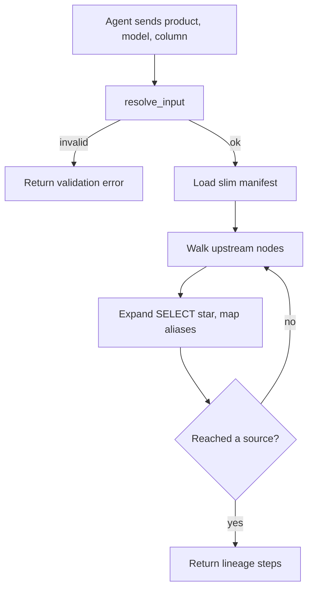

# generate_column_lineage

## Purpose

Traces a column upstream through dbt models to sources. Returns each hop with compiled SQL, and resolves aliases when the column is renamed.

## Diagram

## Inputs

| Argument | Required | Meaning |
|---|---|---|
| `data_product` | yes | Product that owns the model |
| `model_name` | yes | Starting model |
| `column_name` | yes | Column to trace |

## Outputs

On success: `success`, `data_product`, `model_id`, `model_name`, `column_name`, `lineage` (list of hops with `compiled_code`, `level`, optional `source_column`), `lineage_count`, `message`.

On failure: the same shape as `resolve_input` when validation fails, or `error` / `message` if the manifest cannot be parsed.

## Source

[`src/rca_server/tools/column_lineage.py`](../src/rca_server/tools/column_lineage.py)
