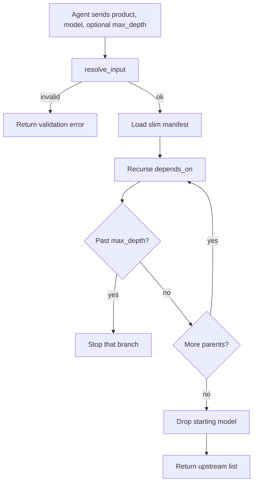

# generate_model_lineage

## Purpose

Traces a dbt model’s upstream dependencies (other models and sources). The starting model is omitted from the result list.

## Diagram

## Inputs

| Argument | Required | Meaning |
|---|---|---|
| `data_product` | yes | Product that owns the model |
| `model_name` | yes | Starting model |
| `max_depth` | no | Max hops; omit for unlimited |

## Outputs

On success: `success`, `data_product`, `model_id`, `model_name`, `lineage` (upstream nodes with `database`, `schema`, `description`, `level`), `lineage_count`, `message`.

On failure: the same shape as `resolve_input` when validation fails, or `error` / `message` if the manifest cannot be parsed.

## Source

[`src/rca_server/tools/model_lineage.py`](../src/rca_server/tools/model_lineage.py)
