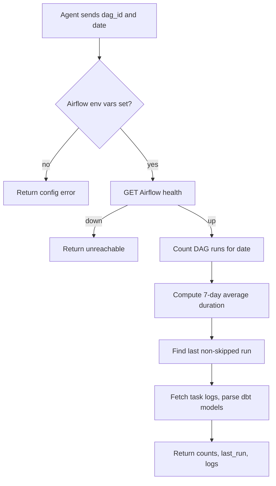

# get_airflow_dag_runs

## Purpose

Looks up Airflow DAG activity for one calendar date: how many runs, 7-day average duration, and logs for the last run that was not fully skipped. dbt model names are parsed from the `run_dbt` task log when present.

## Diagram

## Inputs

| Argument | Required | Meaning |
|---|---|---|
| `dag_id` | yes | Airflow DAG id (from `data_products.json` for a product) |
| `date` | yes | Day to inspect, `YYYY-MM-DD` |

Needs `AIRFLOW_BASE_URL`, `AIRFLOW_USERNAME`, and `AIRFLOW_PASSWORD`.

## Outputs

On success: `success`, `dag_id`, `date`, `total_runs`, `last_run` (id, state, duration, `dbt_models`, per-task logs), `avg_duration_7d_seconds`, `message`, `error_details` (`null`).

On failure: `success` is `false`, `total_runs` is `0`, `last_run` is `null`, plus `message` and `error_details`.

This tool returns only the **last** non-skipped run in detail, not every run that day.

## Source

[`src/rca_server/tools/get_airflow_dag_runs.py`](../src/rca_server/tools/get_airflow_dag_runs.py)
