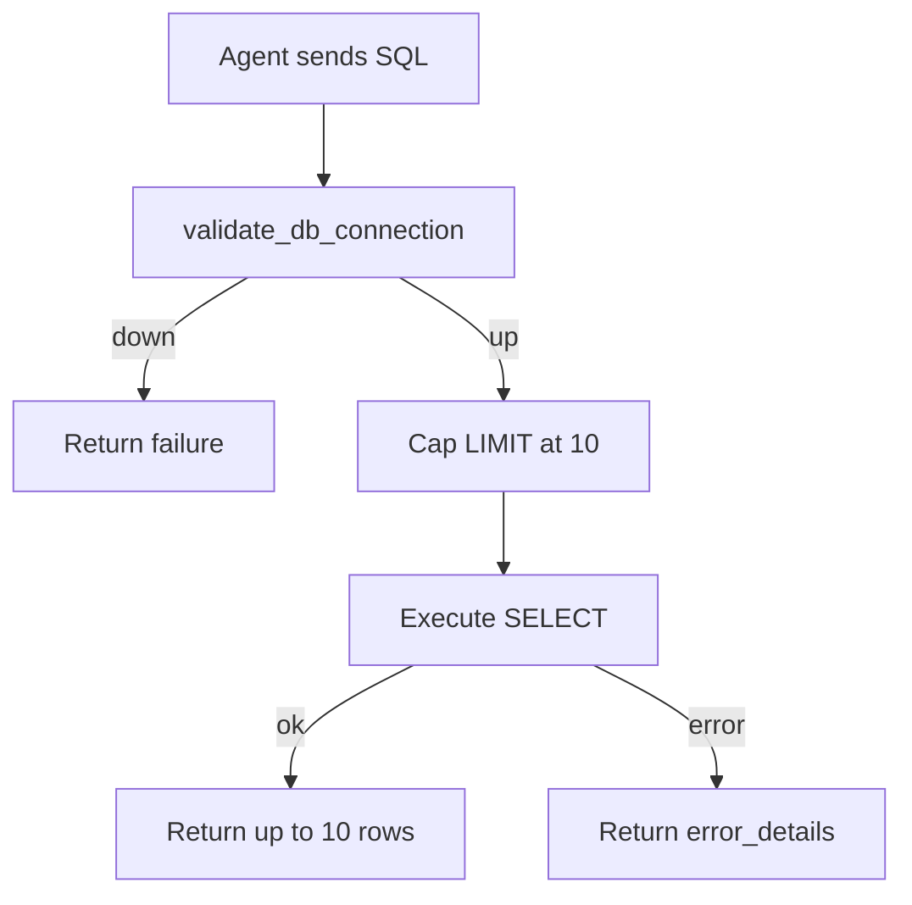

# get_data

## Purpose

Runs a SELECT against Snowflake and returns at most 10 rows. Caps any `LIMIT` at 10. This tool does not call `validate_sql`; the MCP description asks agents to call `validate_db_connection` and `validate_sql` first.

## Diagram

## Inputs

| Argument | Required | Meaning |
|---|---|---|
| `sql` | yes | Snowflake SELECT to run |

## Outputs

| Field | Meaning |
|---|---|
| `success` | Whether the query ran |
| `sql` | SQL that was executed, with LIMIT applied (truncated if long) |
| `row_count` | Number of rows returned |
| `data` | Rows as a list of objects |
| `message` | Short result text |
| `error_details` | Failure reason, or `null` |

## Source

[`src/rca_server/tools/get_data.py`](../src/rca_server/tools/get_data.py)
