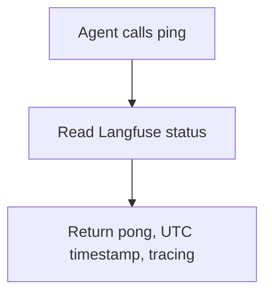

# ping

## Purpose

Health check for the MCP server. Confirms the process is up and reports whether Langfuse tracing is available.

## Diagram

## Inputs

None.

## Outputs

| Field | Meaning |
|---|---|
| `success` | Always `true` if the tool ran |
| `message` | `pong - rca server is running` |
| `timestamp` | Server time in UTC |
| `tracing.enabled` | Whether Langfuse is available |
| `tracing.error` | Langfuse error, or `null` |

## Source

[`src/rca_server/tools/ping.py`](../src/rca_server/tools/ping.py)
