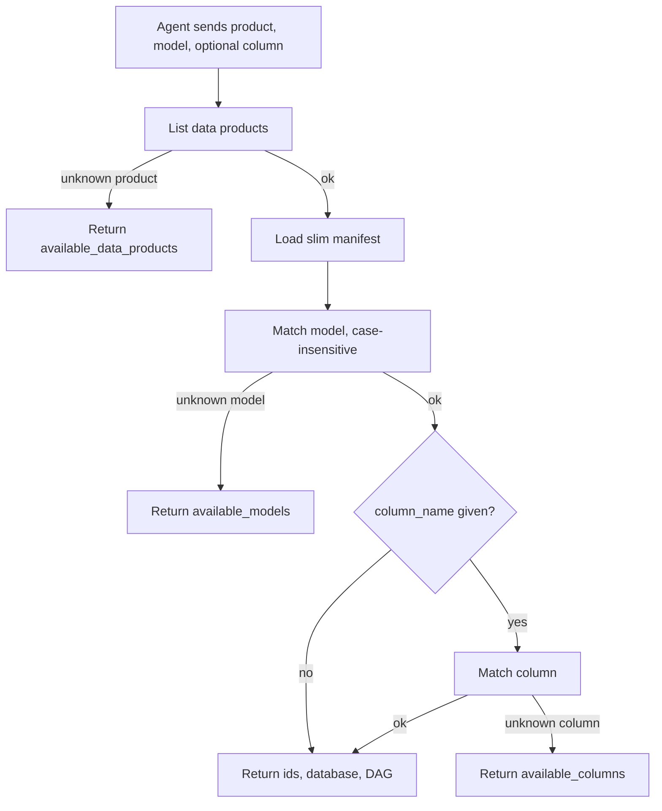

# resolve_input

## Purpose

Validates `data_product`, `model_name`, and optional `column_name` against the dbt slim manifest before lineage tools run. Call this first for any lineage request.

## Diagram

## Inputs

| Argument | Required | Meaning |
|---|---|---|
| `data_product` | yes | Product key from `manifests/data_products.json` |
| `model_name` | yes | dbt model name |
| `column_name` | no | Column to validate on that model |

## Outputs

On success: `success`, `data_product`, `model_id`, `model_name`, `column_name` (or `null`), `database_name`, `airflow_dag_name`, `message`.

On failure: `success` is `false`, plus `error`, `message`, and the matching `available_*` list when the name was unknown.

## Source

[`src/rca_server/tools/resolve_input.py`](../src/rca_server/tools/resolve_input.py)
