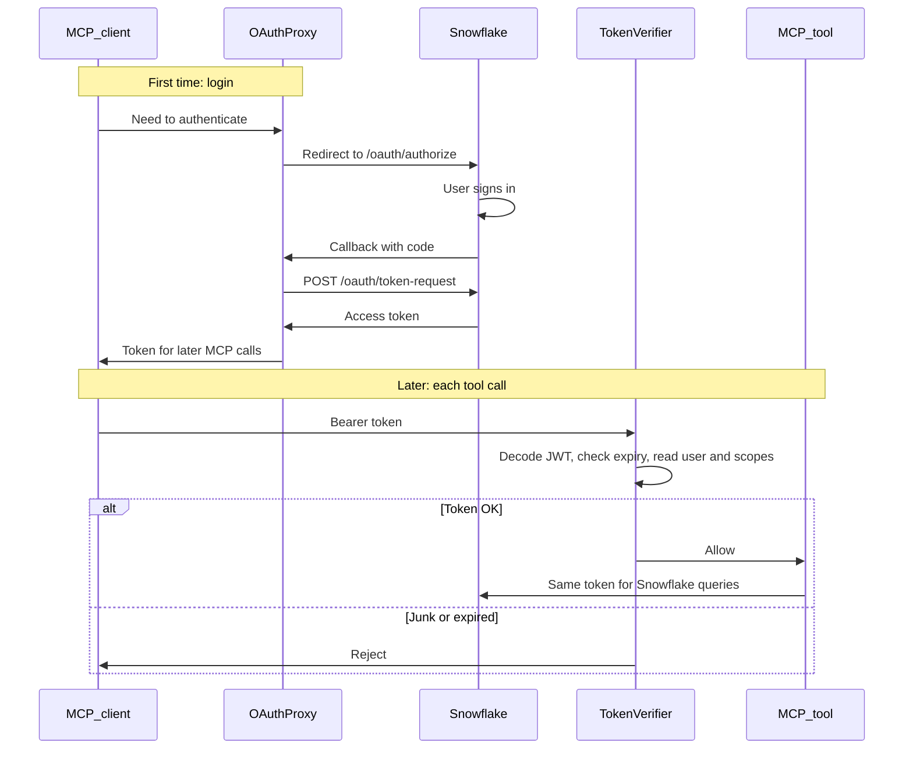

# Snowflake OAuth process

This server does not invent a login protocol. Snowflake already publishes two URLs and an access token ([custom OAuth](https://docs.snowflake.com/en/user-guide/oauth-custom)). FastMCP does not speak Snowflake, so we plug those URLs into FastMCP’s `OAuthProxy` and check the token on later calls.

Code: `src/rca_server/auth/snowflake_provider.py`. Snowflake setup: [`setup_snowflake_oauth.sql`](setup_snowflake_oauth.sql).

## The three pieces

| Piece | What it is | What it does |
|---|---|---|
| `create_snowflake_auth` | Our function | Fills in Snowflake’s URLs, app id/secret, and scopes, then returns an `OAuthProxy` |
| `OAuthProxy` | FastMCP class | Runs the login dance: redirect to Snowflake, take the callback, fetch a token |
| `SnowflakeTokenVerifier` | Our small class | On each MCP request, reads the JWT, rejects junk/expired tokens |

Snowflake docs do not define Python classes. FastMCP requires objects: `FastMCP(..., auth=...)` needs an `AuthProvider` (`OAuthProxy`), and `token_verifier` must be a class with `verify_token`.

## Snowflake URLs

For account `xy12345`:

- Authorize (login page): `https://xy12345.snowflakecomputing.com/oauth/authorize`
- Token (code → access token): `https://xy12345.snowflakecomputing.com/oauth/token-request`
- Scope: `session:role:<ROLE_NAME>` (default `session:role:PUBLIC`)

`create_snowflake_auth` sets those as `upstream_authorization_endpoint` and `upstream_token_endpoint`. `upstream_*` means “the real identity office over there.” `base_url` is this MCP server, from the client’s point of view.

## Workflow

### Step by step

1. **Startup.** `registry.py` calls `create_snowflake_auth(...)` and passes the result to `FastMCP(..., auth=auth)`.
2. **Client hits a protected tool** without a token. FastMCP uses `OAuthProxy` as the login desk.
3. **`OAuthProxy` redirects** the user to Snowflake `/oauth/authorize`.
4. **User logs in at Snowflake.** Snowflake sends them back to this server’s callback (`/auth/callback` in the SQL setup).
5. **`OAuthProxy` calls** Snowflake `/oauth/token-request` with the code, client id, and client secret. Snowflake returns an access token.
6. **The MCP client stores that token** and sends it as `Authorization: Bearer ...` on later calls.
7. **`SnowflakeTokenVerifier.verify_token`** runs on each call: decode JWT, reject if expired, read scopes and username. Signature is not re-checked here; the token already came from Snowflake’s token URL.
8. **If allowed**, tools reuse the same token for Snowflake (`authenticator=oauth` in `snowflake_connection.py`).

## What each piece does not do

- `create_snowflake_auth` does not check tokens. It only builds `OAuthProxy`.
- `OAuthProxy` does not decide “is this token still valid on this tool call?” That is the verifier.
- `SnowflakeTokenVerifier` does not show a login page. Login already happened.

## Config

Set in `.env` (see the SQL script for creating the Snowflake integration):

- `SNOWFLAKE_ACCOUNT`
- `SNOWFLAKE_OAUTH_CLIENT_ID`
- `SNOWFLAKE_OAUTH_CLIENT_SECRET`
- `SNOWFLAKE_OAUTH_ROLES` (comma-separated; becomes `session:role:...` scopes)
- `SERVER_BASE_URL` (must match the OAuth redirect URI)
