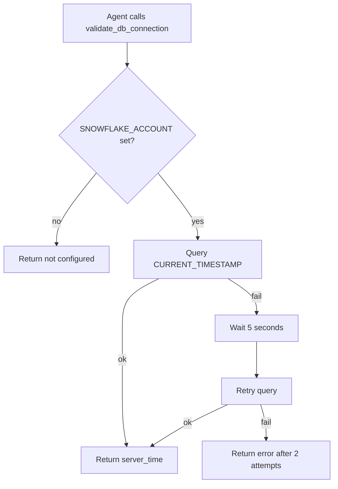

# validate_db_connection

## Purpose

Checks that Snowflake is reachable. Runs `SELECT CURRENT_TIMESTAMP()` and retries once after 5 seconds if the first attempt fails.

## Diagram

## Inputs

None.

## Outputs

| Field | Meaning |
|---|---|
| `success` | Whether Snowflake answered |
| `message` | Short result text |
| `server_time` | Database clock if connected, else `null` |
| `error_details` | Failure reason, or `null` |

## Source

[`src/rca_server/tools/validate_db_connection.py`](../src/rca_server/tools/validate_db_connection.py)
