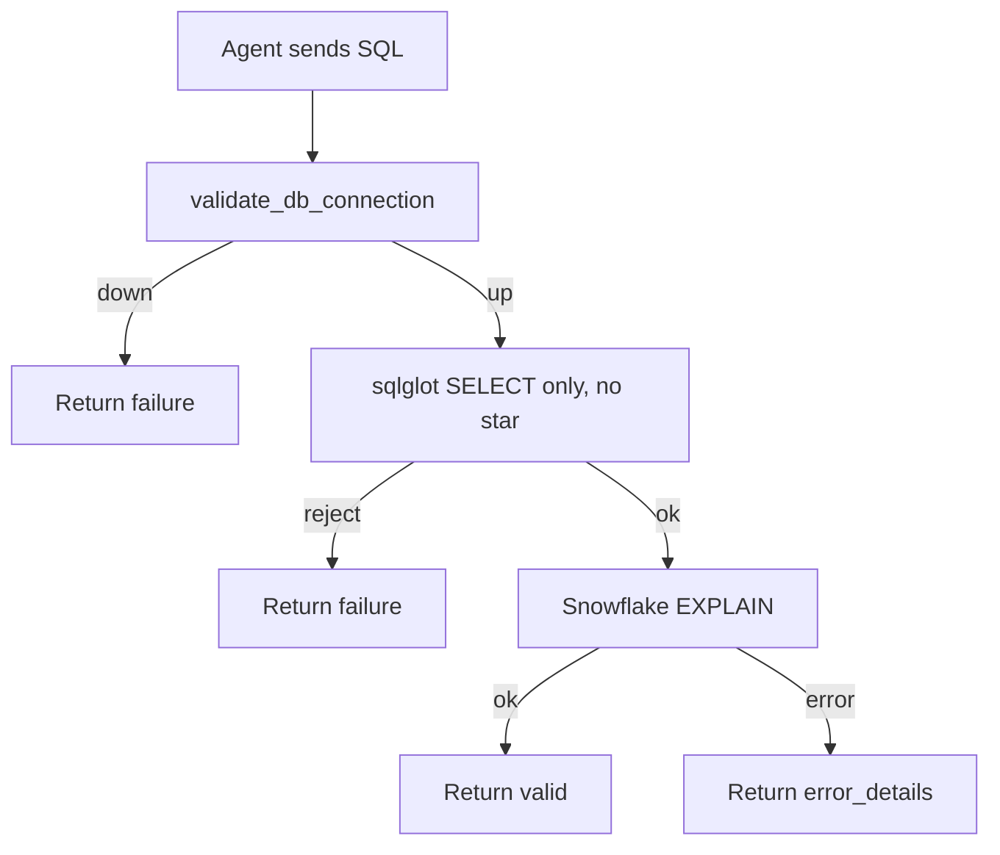

# validate_sql

## Purpose

Checks that a statement is a read-only SELECT with explicit columns, then asks Snowflake to compile it with `EXPLAIN`. The query is not executed.

## Diagram

## Inputs

| Argument | Required | Meaning |
|---|---|---|
| `sql` | yes | Snowflake SELECT to validate |

## Outputs

| Field | Meaning |
|---|---|
| `success` | Whether the SQL compiled as a allowed SELECT |
| `sql` | Input SQL, truncated if longer than 200 characters |
| `message` | Short result text |
| `error_details` | Policy, connection, or Snowflake error, or `null` |

## Source

[`src/rca_server/tools/validate_sql.py`](../src/rca_server/tools/validate_sql.py)
